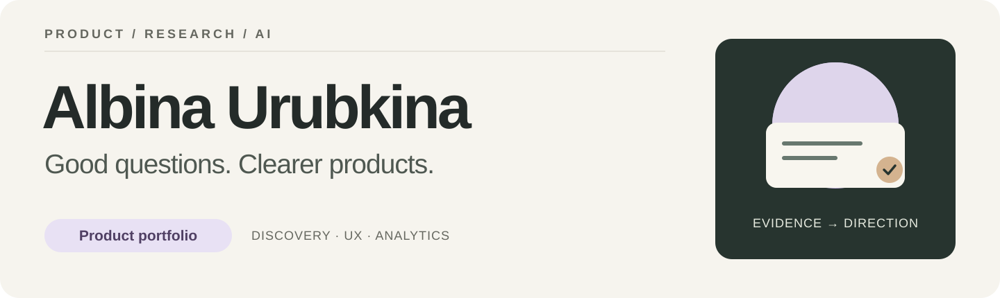
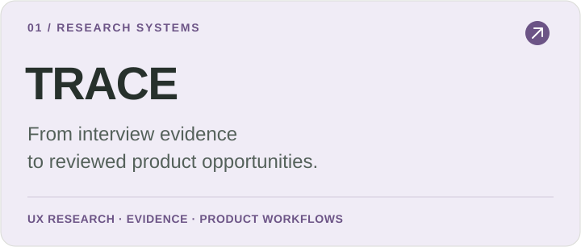
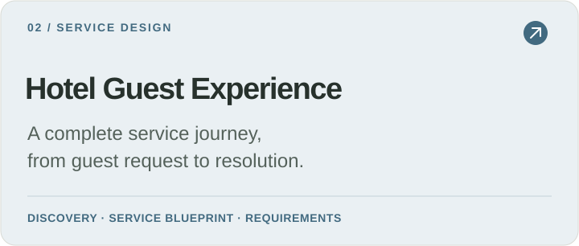
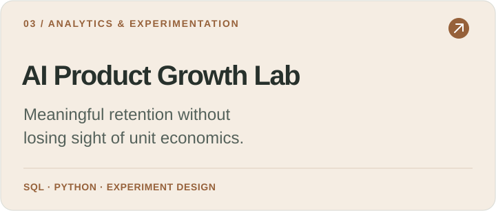
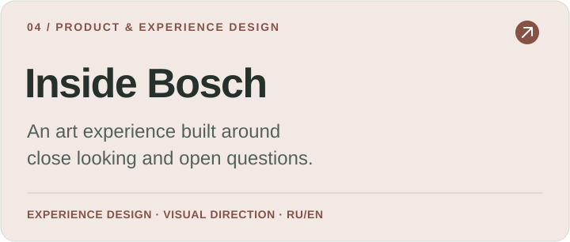
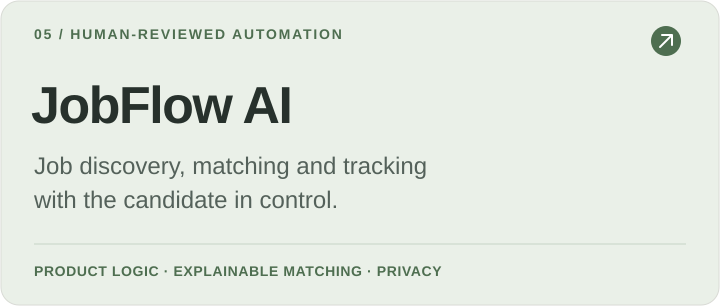
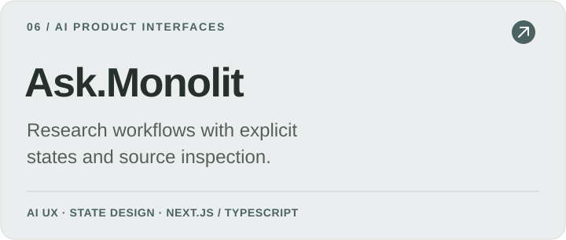

  <a href="#selected-work">Selected work</a> &nbsp;·&nbsp;
  <a href="#how-i-work">How I work</a> &nbsp;·&nbsp;
  <a href="https://github.com/alyalbina/alyalbina/blob/main/README_RU.md">По-русски</a>

## About me

I build product case studies and interactive prototypes across **AI, research, analytics and experience design**. My work connects a product question to customer journeys, requirements, working workflows and a way to evaluate the result.

I care about making evidence easy to inspect, preserving user control and giving complex tools a clear interface. Those priorities run through TRACE, JobFlow, Ask.Monolit and the service and cultural projects below.

My portfolio includes a service-design case developed from my **2024 HSE University thesis in Business Informatics**, alongside independent AI, analytics and cultural projects.

## Selected work

Six projects, six ways to inspect my product thinking. Start with **TRACE** for research workflows or **Hotel Guest Experience** for discovery, service design and requirements.

<table>
<tr>
<td width="50%" valign="top">

A research workspace linking exact quotes, reviewed insights and product opportunities. Working local demo; AI synthesis is a planned extension.

<a href="https://github.com/alyalbina/trace-research-copilot/blob/main/docs/portfolio-case-study.md">Case study</a> · <a href="https://github.com/alyalbina/trace-research-copilot">Source</a>

</td>
<td width="50%" valign="top">

Thesis-based service design, requirements and a reconstructed staff-and-guest workflow. Includes an interactive demo and a research atlas.

<a href="https://alyalbina.github.io/hotel-guest-experience-platform/case-study/">Case study</a> · <a href="https://alyalbina.github.io/hotel-guest-experience-platform/demo/">Demo</a> · <a href="https://github.com/alyalbina/hotel-guest-experience-platform">Source</a>

</td>
</tr>
<tr>
<td width="50%" valign="top">

A reproducible AI-credit simulation, SQL/Python analytics and experiment design, plus a separate real-data UCI study.

<a href="https://alyalbina.github.io/ai-product-growth-lab/">Case study</a> · <a href="https://alyalbina.github.io/ai-product-growth-lab/research.html">Interactive report</a> · <a href="https://github.com/alyalbina/ai-product-growth-lab">Source</a>

</td>
<td width="50%" valign="top">

A bilingual art experience with Deep Zoom, guided discovery and a personal journal. Concept, product direction and visual design.

<a href="https://alyalbina.github.io/inside-bosch/portfolio/index.en.html">Case study</a> · <a href="https://alyalbina.github.io/inside-bosch/">Demo</a> · <a href="https://github.com/alyalbina/inside-bosch">Source</a>

</td>
</tr>
<tr>
<td width="50%" valign="top">

Telegram job discovery, explainable matching and an application workflow. A private local app with a public fictional-data sandbox.

<a href="https://alyalbina.github.io/jobflow-ai/case-study.html">Case study</a> · <a href="https://alyalbina.github.io/jobflow-ai/">Demo</a> · <a href="https://github.com/alyalbina/jobflow-ai">Source</a>

</td>
<td width="50%" valign="top">

A research-product frontend prototype with a deterministic demo adapter, responsive workflows and explicit result states.

<a href="https://github.com/alyalbina/monolit#what-is-implemented">Case study</a> · <a href="https://github.com/alyalbina/monolit">Source</a>

</td>
</tr>
</table>

## How I work

| Area | What I bring |
| :--- | :--- |
| **Discovery & UX** | Customer journeys, service blueprints, experience requirements and interactive prototypes |
| **Product analytics** | SQL, funnels, activation, retention, experiment design and metric definitions |
| **Evidence & quality** | Source links, counter-evidence, review states, reproducible checks and documented limits |
| **Delivery** | MVP scope, requirements, state models, acceptance criteria and API workflows |

I use AI-assisted development to make ideas tangible, document decisions and test product behavior. Each case explains its research evidence, implemented scope and use of demo data.

## Explore further

Open a **case study** for the product reasoning, a **demo** for the interaction, or a **source repository** for the implementation and its limits.

[All repositories](https://github.com/alyalbina?tab=repositories) · [Русская версия](https://github.com/alyalbina/alyalbina/blob/main/README_RU.md)
